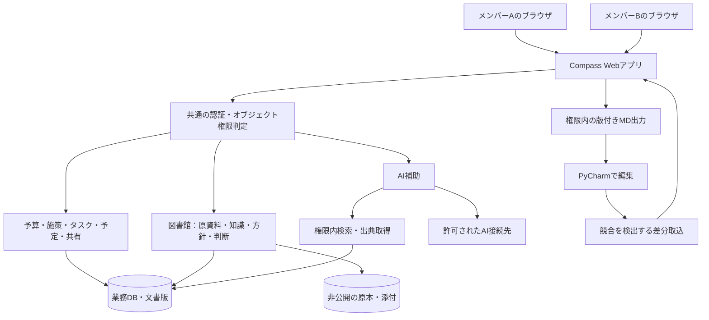

# 構造設計

**Compass は、知識と共同作業を一つのWebアプリにまとめる設計を基本とする。**
名称 Compass と開発先は採用済み。ユーザー作成済みの Django プロジェクトを土台に、既存の `compass/` 設定パッケージと `manage.py` を維持する。
PostgreSQL、業務アプリ、共有認証、取込、AI、worker は今後の設計・実装対象である。
現段階の基盤整備だけでは Project_Knowledge と library の業務データは統合されない。

## 利用方式

利用者は中央サービスへブラウザで接続し、共有状態を中央で管理する。
Webもサーバー・クライアント方式で、ブラウザがクライアントになる。
メンバーの端末同士は直接接続せず、専用クライアントの配布・更新・接続設定を減らす。

| 方式 | 主な管理負担 | 位置づけ |
|---|---|---|
| 既存のローカルアプリ＋共有サーバー | 各端末への配布・更新、個人/共有の切替、接続設定 | 既存資産を保管し、移行対象を検証する |
| 中央Webサービス | 中央の更新、認証、DB・原本・バックアップの管理 | Compass の推奨方式 |
| ローカルとWebの常時自動同期 | 競合、オフライン編集、権限変更、配布の管理 | 初期範囲に含めず、必要性が確定したら追加検討 |

既存アプリの予算計算・検証・抽出処理を再利用候補にし、接続・認証・保存層を段階的に置き換える。
既存APIのOrigin拒否を解除するだけでWeb化を完了としない。

## 論理構造



図の各機能は一つのアプリ内の責務である。初期からマイクロサービスへ分割しない。
抽出・索引・AI等の重い処理はWeb要求と実行経路を分けても、同じコードとリリースで管理する。

## 技術の位置づけ

| 部分 | 構成 | 現在の位置づけ |
|---|---|---|
| アプリ | Python + Django | ユーザー作成済みの基盤を継続 |
| 設定・起動 | `compass/`、`manage.py` | 既存配置を維持。旧案の `config/` へ改名しない |
| 画面 | Djangoテンプレート＋必要なJavaScript | 推奨。独立したフロントエンド環境を初期必須にしない |
| 開発用DB | SQLite | 現在の開発基盤。共同利用の本番DBとは分ける |
| 共同利用DB | PostgreSQL | 推奨。導入・接続・本番運用は未実施 |
| 原本 | 非公開のファイル保存領域と共通保存API | 推奨。ローカル領域/オブジェクト保存は運用条件で選択 |
| 検索 | 日本語の部分一致、メタデータ、章単位検索 | 初期案。実資料で品質評価する |
| 意味検索 | 必要に応じたDB拡張等 | 後続評価。専用ベクトルDBを前提にしない |
| 重い処理 | 同一リポジトリのworker＋ジョブ状態管理 | 設計案。再試行・中断・重複実行防止が必要 |
| 認証・権限 | Google Workspace方針の継承＋オブジェクト権限 | 設計案。Django標準のモデル権限だけでは文書単独共有を満たさない |
| 文書 | Markdown + MkDocs | 今回の整備対象。製品内の図書館機能とは別の開発文書環境 |

## ディレクトリの責務

以下は**目標となる責務配置**。業務機能の各サブディレクトリは実装に合わせて追加する。
空のDjangoアプリを一括生成して機能があるように見せず、必要な機能から着手する。

```text
Compass/
├── AGENTS.md                 # AI向けの共通作業ガイド
├── README.md                 # 人間向けの入口と開始手順
├── pyproject.toml            # Pythonと文書環境の依存
├── uv.lock                   # 解決済みの依存
├── .gitignore
├── .env.example              # 設定名の例。秘密値は置かない
├── manage.py                 # Django管理コマンド
├── compass/                  # 既存の設定・URL・ASGI/WSGI
├── apps/                     # 業務機能。実装時に下記の境界で追加
│   ├── accounts/             # 社員・グループ・ログイン
│   ├── projects/             # プロジェクト・所属
│   ├── permissions/          # オブジェクト権限の共通判定
│   ├── inbox/                # 未分類メモ・取込
│   ├── library/              # 文書版・原本・知識・方針・判断
│   ├── budgets/              # 予算版・実績・科目・配賦
│   ├── initiatives/          # 施策・指標・振り返り
│   ├── tasks/                # 依頼・担当・結果提出・確認
│   ├── schedules/            # 日付の表示・マイルストーン
│   ├── collaboration/        # コメント・通知
│   ├── ai/                   # 検索・出典・提案・利用制御
│   ├── imports/              # 旧資料・予算・DBの取込
│   ├── exports/              # 版付きMD・CSV・原本出力
│   ├── jobs/                 # 抽出・索引・AIジョブ
│   └── audit/                # 操作・変更履歴
├── templates/                # Web画面のテンプレート
├── static/                   # CSS・JavaScript
├── docs/                     # 製品の要件・設計・開発・運用文書
│   ├── requirements/
│   ├── architecture/
│   ├── decisions/
│   ├── migration/
│   ├── operations/
│   └── reference/
├── tests/                    # 統合・権限・移行・受入の検証
├── tools/                    # 開発・検証・移行の補助
└── deploy/                   # 将来の配置・監視・バックアップ構成
```

小さいアプリは `models.py`、`services.py`、`views.py` 等から始め、必要に応じて分割する。
`apps/projects/` はプロジェクト管理のコードであり、利用者の事業資料を置く場所ではない。
`templates/` は画面の雛形で、図書館の文書雛形とは用途が異なる。
ID・正本・原本・権限の詳細は [データ・権限設計](data-and-access.md)を参照する。

## コードと実データ

設計・運用文書は `docs/`、利用者の事業資料・DB・添付・出力はGit管理外の実データ領域に保存する。
library の全資料や Project_Knowledge のDBをこのコードリポジトリへ一括コピーしない。
Gitの閲覧権限やドキュメントサイトの公開範囲は、業務資料の文書単位ACLの代替にならない。

本番は、リリースされたコード、実行設定・秘密設定、DB、原本・添付、取込途中、一時出力、ログ、別系統のバックアップを分ける。
原本の物理パスを利用者の分類体系として使わず、文書IDと権限判定を通して取得する。

試行は既存Ubuntu資産を候補にできる。本番で保守の手間を優先する場合は、管理されたアプリ実行基盤・PostgreSQL・原本保存を検討する。
本番配置先、接続範囲、運用担当、費用は未決定で、今回の整備にクラウド契約・本番デプロイは含まれない。
